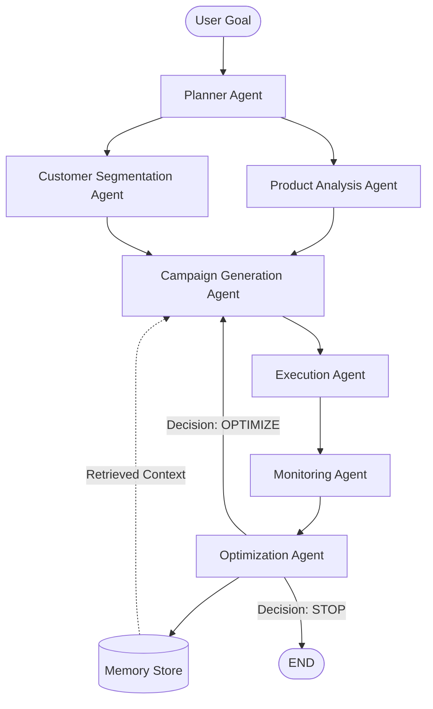

# Architecture

## System Overview

The system is a **multi-agent pipeline** orchestrated by **LangGraph**.  
Each agent is a node in a directed graph; shared state (`WorkflowState`) flows between them.



## Key Design Principles

### 1. LLM vs Deterministic Split

| Task Type | Engine | Examples |
|---|---|---|
| **Language reasoning / generation** | LLM | Goal decomposition, copy writing, decision rationale |
| **Arithmetic, filtering, scoring** | Python / Pandas / SQL | KPI calculation, segmentation, budget allocation |

This prevents hallucinated numbers and ensures reproducible analytics.

### 2. Typed Data Flow

All inter-agent communication uses **Pydantic models** defined in `app/models/schemas.py`.  
The LangGraph graph passes a single `WorkflowState` object through every node.

### 3. Shared State

```
WorkflowState
├── goal: UserGoal
├── plan: ExecutionPlan
├── product_info: ProductInfo
├── segments: list[CustomerSegment]
├── campaigns: list[Campaign]
├── execution_results: list[ExecutionResult]
├── metrics: list[CampaignMetrics]
├── optimization: OptimizationRecommendation
├── optimization_iteration: int
├── errors: list[str]
├── logs: list[str]
└── completed: bool
```

### 4. Conditional Workflow

The optimisation node evaluates campaign metrics against configurable thresholds:
- **OPTIMIZE**: loop back to Campaign Generation (up to `MAX_OPT_LOOPS`)
- **CONTINUE**: keep running the current campaign
- **STOP**: end the workflow

### 5. Long-Term Memory

SQLite stores:
- Campaign outcomes and what content performed well
- Segment performance history across runs
- Optimisation decisions and their measured impact

Agents query this store to inform future decisions.

### 6. LLM Provider Abstraction

```
LLMProvider
├── OllamaBackend     (local, default)
├── OpenAIBackend     (API key via env)
└── DemoBackend       (deterministic, no network)
```

### 7. Demo Mode

When `DEMO_MODE=true`:
- LLM calls return deterministic canned responses
- Execution agent generates synthetic delivery metrics
- No network access required
- Fully reproducible for grading and demonstrations

## Data Flow

```
CSV (data/raw/)
    │
    ▼
DataService ──► Pandas DataFrames
    │                    │
    │                    ▼
    │            Agent processing
    │                    │
    ▼                    ▼
SQLite DB ◄──── MemoryStore
    │
    ▼
Streamlit Dashboard (Plotly charts)
```

## Technology Stack

| Layer | Technology |
|---|---|
| Orchestration | LangGraph (StateGraph) |
| Schemas | Pydantic v2 |
| Analytics | Pandas, NumPy |
| Database | SQLite3 (stdlib) |
| LLM (local) | Ollama + qwen3:8b |
| LLM (cloud) | OpenAI-compatible API |
| Dashboard | Streamlit + Plotly |
| Testing | Pytest + pytest-asyncio |
